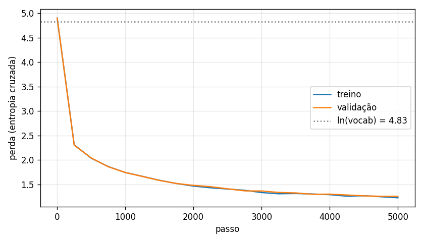
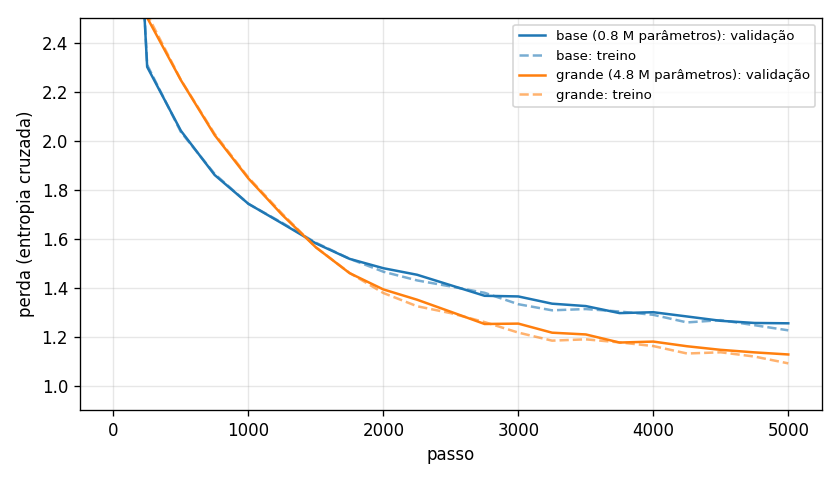

# Medical Mini-GPT

A small GPT, built from scratch in PyTorch and trained on questions from Brazilian medical exams (Revalida and Enare). A university group project based on Andrej Karpathy's nanoGPT.

> The model predicts the next character. It imitates the style of the questions, but it does **not** give reliable medical information.

The code, comments and corpus are in Portuguese, so command-line flags such as `--temperatura` keep their Portuguese names.

## Status

| Step | Contents | Status |
| --- | --- | --- |
| 1. Data and tokenization | `data/prepare.py`, `char_tokenizer.py`, `data/loader.py` | Done |
| 2. Architecture | `model.py` | Done |
| 3. Training | `train.py` | Done |
| 4. Generation and evaluation | `generate.py` | Done |
| 5. Experiments | `configs/`, `compare.py`, `results/` | Done (base, large and context) |
| 6. Interface | `app.py`, `interface/index.html` | Done |

## Layout

```
data/prepare.py        downloads, cleans, splits and tokenizes the corpus
data/loader.py         builds the (x, y) batches for training
char_tokenizer.py      character-level tokenizer
configs/base.json      initial hyperparameters
notebooks/             data exploration (run on Kaggle)
model.py               the Transformer: causal attention, blocks and output head
train.py               training loop, validation loss, checkpoint and loss curve
generate.py            generates text with temperature and top-k; compares temperatures
compare.py             compares the experiments: table and curves in results/
configs/grande.json    step 5 experiment: a 5.8x larger model
configs/contexto.json  step 5 experiment: the large model with context 128
relatorio/             study report in LaTeX (relatorio.pdf, in Portuguese)
app.py                 browser interface with a prompt bar
interface/index.html   the interface page
tests/test_etapa1.py   sanity tests, run without internet
tests/test_etapa2.py   model tests: shapes, causality, initial loss
tests/test_etapa3.py   short training run on fake data: the loss must drop
tests/test_etapa4.py   generation: context, top-k, temperature, reproducibility
checkpoints/           saved models (.pt), ignored by git
results/               loss curves and generated samples
```

## Running step 1

```bash
pip install -r requirements.txt
python tests/test_etapa1.py   # checks that everything is in place (no internet needed)
python data/prepare.py        # downloads HealthQA-BR and writes data/processed/
```

On Kaggle: create a notebook, turn on **Settings → Internet: On**, clone the repository and run `notebooks/01_exploracao_dados.ipynb`.

## Training (step 3)

```bash
python train.py                      # configs/base.json, 5,000 steps
python train.py --max-iters 300      # quick test, about 1 minute on CPU
python train.py --config configs/outra.json   # another experiment (step 5)
```

The model with the lowest validation loss is saved to `checkpoints/<config name>.pt`. The curve and the losses go to `results/<config name>/`. The script uses the GPU automatically when there is one (on Kaggle: **Settings → Accelerator → GPU**).

## Trying it in the browser

```bash
python app.py
```

Opens `http://localhost:8000` with a ChatGPT-style prompt bar. The text appears character by character as the model generates it. You can choose the model (`base` or `grande`), the temperature, top-k and the length of the text. Nothing beyond `requirements.txt` is needed: the server uses Python's built-in `http.server`. Press Ctrl+C in the terminal to stop it.

To let the class open it on their phones, on the same Wi-Fi network:

```bash
python app.py --rede
```

The terminal and the top of the page show the address to type on the phone, such as `http://192.168.0.12:8000`. At most two generations run at once; other requests wait in a queue. Things to keep in mind:
- Anyone on the same network can open the page while the server is running. Stop it with Ctrl+C after the presentation.
- The first time, Windows may ask about the Firewall. Allow it on **private networks** only.
- Many university networks block connections between devices. If phones can't open the page, use your phone's hotspot: connect the laptop to it and ask the class to join it too.

## Generating text (step 4)

```bash
python generate.py                                       # 500 characters starting from "### Revalida"
python generate.py --inicio "### Enare" --temperatura 0.5 --top-k 10
python generate.py --amostras 3 --n 300
python generate.py --comparar                            # writes results/base/amostras.md
```

## Data

[HealthQA-BR](https://huggingface.co/datasets/Larxel/healthqa-br): 5,632 multiple-choice questions from Revalida, Enare Residência Médica and Enare Multiprofissional, in Portuguese, licensed CC-BY 4.0.

Each question becomes a block of text:

```
### Revalida 2013 | Clínica Médica
Homem com 49 anos de idade apresenta...
(A) ...
Gabarito: C
```

The header gives the corpus structure: in the demo, starting with `### Revalida` is enough for the model to write a question.

## Step 1 decisions

- **Character-level tokenization:** a small vocabulary and code that is easy to explain. BPE is left as a step 5 experiment.
- **Cleaning:** Unicode normalization (NFC), standardized quotes and dashes, repeated spaces removed, characters with fewer than 3 occurrences dropped. All of this shrinks the vocabulary without changing the meaning.
- **Homoglyphs:** the original text, copied from PDFs, contains Greek and Cyrillic letters that look like Latin ones (`Allium ceра` with a Cyrillic "р", option `Ε` with a Greek epsilon). They are replaced by the Latin letter; otherwise "o" and "о" would be different tokens.
- **Options:** in the dataset they come as a Python dictionary (`'A': 'text'`, sometimes over several lines). They become `(A) text` on a single line.

### Corpus after `prepare.py`

| Measure | Value |
| --- | --- |
| Questions (train / validation) | 5,069 / 563 |
| Size | 5.25 MB |
| Train / validation characters | 4,574,978 / 508,218 |
| Vocabulary | 125 characters (144 before handling homoglyphs and equivalent symbols) |
| Expected initial loss ln(125) | 4.83 |

- **90/10 train/validation split by question:** questions are shuffled before the split, so validation covers every exam and year and no question is cut between the two sets.
- **Batches:** `y` is `x` shifted by one position; every position in the block is a "predict the next character" example.
- **Sanity check:** the expected initial loss is ln(vocabulary size), stored in `data/processed/meta.json`. The model's first loss has to match it.

## Step 2 decisions

`model.py` is a decoder-only Transformer, like GPT:

```
ids -> character embedding + position embedding
    -> 4 blocks [LayerNorm -> causal attention (4 heads) -> residual add
                 LayerNorm -> MLP (4x wider, GELU)       -> residual add]
    -> LayerNorm -> linear layer -> logits (125 scores, one per character)
```

- **Causal attention:** a triangular mask stops each position from seeing the following ones. Without it, predicting the next character would just be copying it.
- **1/sqrt(d) scaling:** keeps the q·k products small so the softmax doesn't saturate early on.
- **Pre-norm and residual connections:** as in GPT-2; they let the gradient reach the first layers and stabilize training.
- **Initialization with std 0.02:** logits start near zero and the initial loss is close to ln(125).
- **Hand-written attention** (instead of `F.scaled_dot_product_attention`): slower, but every step of the formula is visible in the code.

With `configs/base.json` the model has **833,661 parameters**. The initial loss measured on a real batch was **4.90**, close to the expected 4.83.

The tests in `tests/test_etapa2.py` check that:
- input and output shapes are correct;
- changing one character does not change the predictions for earlier positions (causality);
- the initial loss is close to ln(vocabulary);
- the model can memorize a small batch, a sign that the gradient reaches every layer.

## Step 3 results

Training with `configs/base.json` on CPU: 5,000 steps in 12.7 minutes.

| Measure | Value |
| --- | --- |
| Initial loss (train / validation) | 4.90 / 4.90 |
| Final loss (train / validation) | 1.23 / 1.25 |
| Fastest drop | 4.90 → 2.30 in the first 250 steps |



- **No overfitting:** the train and validation curves stay together until the end. Since validation loss was still falling at step 5,000, training longer would probably help (a step 5 experiment).
- **The first 250 steps** teach the easy parts: which characters are frequent, spaces between words, common syllables. After that progress slows down: whole words, the `(A) ... (B) ...` format, the `### Exam Year` header.
- **What a loss of 1.25 means:** on average the model gives the correct character a probability of e^(-1.25) ≈ 29%, against 1/125 = 0.8% at the start.
- **Choices:** AdamW with a fixed learning rate (0.001), loss averaged over 100 batches every 250 steps, and the checkpoint keeps the model with the lowest validation loss, together with the config and the vocabulary.

A sample generated from `### Revalida`: the format is right, with header, question and options, but the content does not make sense yet.

```
### Revalida 2024
Uma mulher de 64 anos negatinas de idade, com sinais de 10 para a criança de endovenoscopia:

(A) prescrição do soro abdominal e metabólico.
(B) incluição para o diagnóstico de estrepmetido.
```

## Step 4 results

Generation is **autoregressive**: the model predicts one character, it is appended to the text, and the text goes back into the model. The model only sees the last 64 characters (`block_size`).

Two sampling controls:
- **Temperature:** divides the logits before the softmax. Low makes the text safe and repetitive; high makes it varied and full of mistakes.
- **Top-k:** samples only among the k most likely characters, cutting the strangest mistakes.

**Evaluation.** Validation perplexity is e^1.25 ≈ **3.5**: at each character the model is as unsure as if it were picking between 3 or 4 options, against 125 at the start. To measure the quality of generated text, we count the fraction of generated words (3+ letters) that exist in the corpus. Average of 5 samples of 400 characters starting from `### Revalida`:

| Temperature | Real words | Real words with top-k = 10 |
| --- | --- | --- |
| 0.5 | 89% | 90% |
| 0.8 | 80% | 83% |
| 1.0 | 71% | 72% |
| 1.2 | 57% | 62% |

- Low temperatures get more words right but repeat phrases ("de saúde de ... de saúde").
- Top-k helps most at high temperatures, where the tail of unlikely characters weighs more.
- At every temperature the **format** comes out right: `### Exam Year | Field` header, question, options `(A)`, `(B)`... and `Gabarito:`. The **content** makes no medical sense: the model learned the shape of the questions, not medicine.
- A limited metric: it accepts real words in meaningless sequences.

Full samples in [`results/base/amostras.md`](results/base/amostras.md).

## Step 5 results

Two experiments, changing one thing at a time:
1. **Larger model** (`configs/grande.json`): only the size changes (5.8 times more parameters).
2. **More context** (`configs/contexto.json`): same as the large model, only `block_size` changes from 64 to 128.

```bash
python train.py --config configs/grande.json     # about 48 min on CPU
python train.py --config configs/contexto.json   # about 2 h on CPU
python compare.py                                # writes results/comparacao.md and comparacao.png
```

Losses on the whole validation set, with a **sliding window**: each character is predicted with at least half of the model's context. Side-by-side windows give little context to the first characters of each window and make the comparison between different contexts unfair. Options in order: the fraction of consecutive option pairs that come out in order, `(A)` → `(B)`, over 90 texts of 1,000 characters per model.

| Model | Parameters | Context | Val. loss | Perplexity | Options in order | CPU time |
| --- | --- | --- | --- | --- | --- | --- |
| Count-based 6-gram | – | 5 | 1.142 | 3.13 | – | – |
| Transformer base | 833,661 | 64 | 1.193 | 3.30 | – | 13 min |
| Transformer large | 4,819,581 | 64 | 1.055 | 2.87 | 42.7% (76/178) | 48 min |
| Transformer context | 4,835,965 | 128 | **1.015** | **2.76** | **74.6% (94/126)** | 120 min |



- **Size:** the large model ended well below the base and beat the 6-gram. It starts more slowly, and with the same CPU time (13 min) the base wins.
- **Context:** the loss fell only a little (1.055 → 1.015), but options in order jumped from 42.7% to 74.6% (two-proportion test: z ≈ 5.5). Long context matters at few points in the text, but those are the ones that give the question its structure.
- The context-128 model barely moves until step 1,000 and overtakes the large model around step 2,750.
- Each model was trained once, with a single seed. Repeating with other seeds would make the conclusions more reliable.

The full report, with the theory behind each step, is in [`relatorio/relatorio.pdf`](relatorio/relatorio.pdf) (in Portuguese).

## References

- Karpathy, *Let's build GPT: from scratch, in code, spelled out* (video) and the nanoGPT repository.
- Vaswani et al., *Attention Is All You Need* (2017).

## License

The code is under the MIT license (see [`LICENSE`](LICENSE)).

The data comes from [HealthQA-BR](https://huggingface.co/datasets/Larxel/healthqa-br), published under CC-BY 4.0. The corpus is not distributed in this repository: `data/prepare.py` downloads and processes the original dataset. If you use the data or text generated from it, credit HealthQA-BR as the source.
