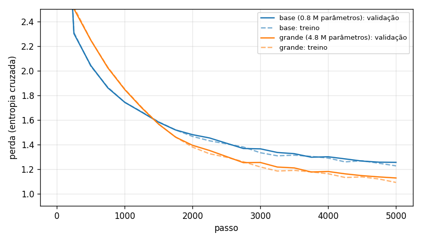

# Comparação dos experimentos



Palavras reais: média de 5 amostras de 400 caracteres a partir de `### Revalida`, temperatura 0.8, mesma semente para todos.

| Experimento | Parâmetros | Perda val | Perplexidade | Treino − val (fim) | Tempo | Palavras reais |
| --- | --- | --- | --- | --- | --- | --- |
| base | 833,661 | 1.2542 | 3.51 | -0.0287 | 13 min (cpu) | 80% |
| grande | 4,819,581 | 1.1270 | 3.09 | -0.0363 | 48 min (cpu) | 87% |

Treino − val negativo: o modelo vai melhor no treino que na validação (começo de overfitting).

# Amostras (primeira de cada experimento)

## base

```
### Revalida 2024 | Terapia coletiva
O paciente de um episódio de relação peso agudo, nas condutas ou a elesão das enconhecidas. Ao exame físico, mostra-se de albumina tipaneopatose e os pesos em insuficiências no trace de respectivamente sintomal de diarreia e a fase manterrial especialmente.
(C) resposta utilizada como para episódios dias.
(B) Assinale a apresentar o diagnóstico de processo do venos único o
```

## grande

```
### Revalida 2014
Uma mulher com 44 anos de idade, sem prevenção de mecânio anti-hipertenso. Em sinais de esclerose impulsiva em espectronente quadro de possa albumina tipa e pancreática pelo membro inferior de nefrologia à segmentação;
(E) onda endoscopia hormonal do manijor de atenção acessociada a que, está visar monocal.
(B) Escular não com lesão adequado para paciente é:

(A) deu granulato e risco de rot
```
